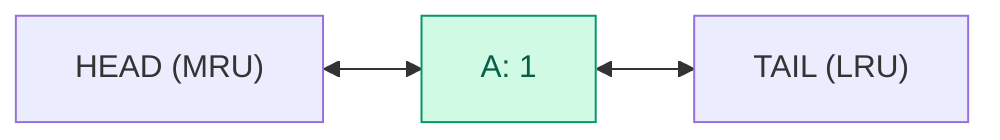
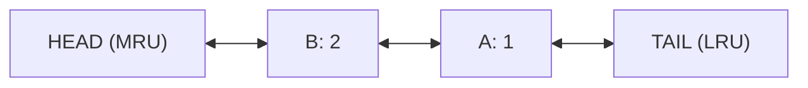
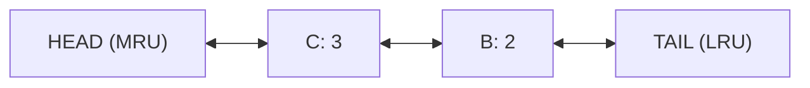

# LRU: Least Recently Used Cache

<p>LRU Cache (Least Recently Used) is a caching mechanism. The way it works is
your system tracks whenever a cached item is either consulted or updated,
so it can remove / evict the cached item that wasn't used recently when you want
to add a new item and cache is full.
</p>

<p>Nowadays, programming languages has built-in implementations for this. But, implementing it by hand
gives you insights of how it really works and that its helpful for scenarios where you need to pick
the right caching mechanism or debugging a weird caching error in Production.
</p>

>Python has LRU built-in as decorator. You can import it from functools.
>
>Just be aware that `functools.lru_cache` has the arg `maxsize` default value to 128. So you can modify the capacity depending on your use case.

Example:

```python
from functools import lru_cache

@lru_cache
def hipster_factorial(n: int) -> int:
    if n == 0 or n == 1:
        return 1

    return n * hipster_factorial(n - 1)
```

## Implementation

<p>Implementing LRU requires 2 things:
  1. To `get` or `put` key-value in time complexity `O(1)`
  2. To keep the eviction / removal of the least recently used item in time complexity `O(1)`
</p>

<p>So we need to use data structures to do this. For the item 1, we will use a Hash Map and for the item 2
is a double-linked list.
</p>

### Why a double-linked list?

The theoric implementation of LRU uses a sequence or counter that sums up on `get` or `put` and assign it to the affected item. This counter gives you the order of the items in the cache but also the time where they were recently used. In this example you will see what I mean:

#### 1. Adding the 1st item (A)



### 2. Second item added (B)



### 3. Third item added (C) — item (A) removed / evicted



<p>Few things you can spot here is we added the most recent used item to the `HEAD` and the least used item was on the `TAIL`, the sequence keeps the order. The data structure that allows you to add items to the `HEAD` and also remove items from the `TAIL` in time complexity O(1) is a double-linked list. That's why combining Hash Map + double-linked list give us a time complexity O(1).
</p>

### Python OrderedDict

In Python, there is a data structure that combines a Hash Map with a double-linked list to bring a `dict` that keep the insertion order and provide optimized methods for sort and compare it, it's called `collections.OrderedDict`
